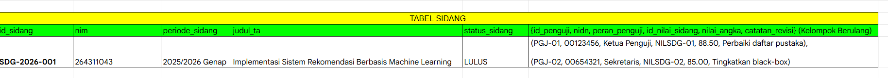
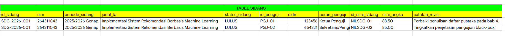
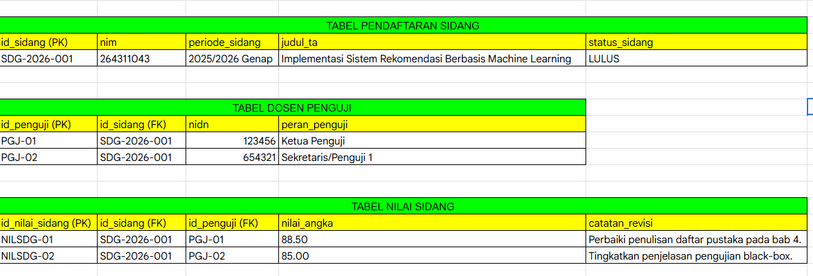
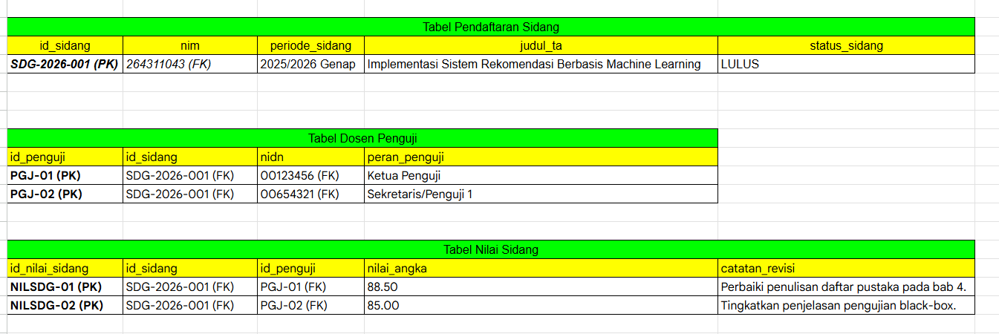

1.	Latar Belakang
   
Dalam proses pengembangan sistem informasi akademik (SIAKAD) yang andal, perancangan basis data memegang peranan krusial untuk memastikan integritas,
efisiensi, dan konsistensi data tetap terjaga dengan baik. Namun, seiring dengan dinamika kebutuhan operasional kampus yang terus berkembang, sistem akademik
konvensional sering kali menghadapi kendala fungsional—salah satunya adalah belum terintegrasinya pengelolaan dan rekapitulasi nilai ujian akhir mahasiswa secara
terpusat. Hal ini memicu tantangan administratif yang rentan terhadap redundansi dan kesalahan pencatatan manual, sehingga diperlukan adanya perluasan entitas dan
proses bisnis baru ke dalam basis data yang ada.

Sebagai bentuk perbaikan dan evaluasi mandiri dalam pemodelan data terstruktur, laporan remedial ini difokuskan pada perancangan tambahan Modul Sidang Tugas Akhir (Skripsi)
yang diselaraskan dengan basis data SIAKAD yang telah dibangun sebelumnya. Melalui tahapan pemodelan komprehensif yang meliputi pemodelan konseptual (ERD), pemodelan logis
melalui teknik normalisasi (1NF hingga 3NF), hingga pemodelan fisik menggunakan implementasi SQL DDL dan DML, penambahan modul ini diharapkan mampu memberikan solusi optimal
dalam mengelola alur pendaftaran sidang, penugasan dosen penguji, serta pencatatan komponen nilai secara akurat dan terstandarisasi.

2. Pemodlean Konseptual
   
    -Pertambahan bisnis untuk menghasapi masalah :
     

   -ERD secara keseluruhan :
    

3. Permodelan login dan normalisasi :

   Transformasi data dari bentuk dokumen pendaftaran sidang manual ke dalam kaidah normalisasi basis data:
   
   1.	Unnormalized Form (UNF): Dokumen pendaftaran sidang mentah yang masih mencampurkan data mahasiswa, judul tugas akhir,        daftar seluruh dosen penguji, dan rincian nilai komponen dalam satu format lembar rekapitulasi yang memiliki nilai           berulang (multi-valued).
      

   2. First Normal Form (1NF): Menghilangkan kelompok atribut berulang. Setiap baris data dibuat bernilai atomik (tunggal),        sehingga setiap penguji dan komponen nilainya berdiri di baris terpisah.
      
   
   3. Second Normal Form (2NF): Menghilangkan ketergantungan parsial (Partial Dependency) dengan memisahkan atribut                berdasarkan entitas utamanya, menghasilkan tabel terpisah untuk MAHASISWA, DOSEN, PENDAFTARAN_SIDANG, dan                    DOSEN_PENGUJI.
      

   4.	Third Normal Form (3NF): Menghilangkan ketergantungan transitif (Transitive Dependency), memastikan seluruh atribut          non-kunci bergantung penuh secara langsung pada Primary Key masing-masing tabel tanpa perantara.
      

4. Permodelan fisik saya tulis di file terpisah

